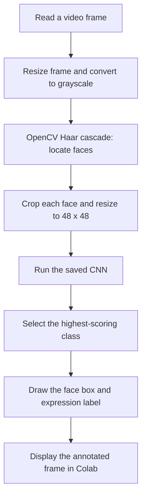

<div align="center">


# Project 2
### Trip Planner Chatbot & Facial-Expression Detection

**Year 1 coursework · January 2024**

Two notebook-based explorations of AI: a conversational travel assistant built with Rasa, and a convolutional neural network for classifying facial expressions in video.

[Trip planner](Part%201/Trip_Planner_%28Project_2%29_version4.ipynb) · [Facial-expression notebook](Facial_expression_detection_Part_2_%28Project2%29.ipynb) · [Project presentation](Presentation/Project%202%20presentation.pptx)

</div>

---

## Explore the project

| | Part 1 — Language | Part 2 — Computer vision |
| :--- | :--- | :--- |
| **Question** | How can a chatbot recognise travel questions and respond through predefined conversations? | How can a CNN classify facial expressions and annotate faces in video? |
| **Approach** | Rasa intents, training examples, stories and response templates | Keras CNN, directory-based image generators and OpenCV face detection |
| **Main tools** | Python, Rasa, spaCy, Jupyter | Python, TensorFlow/Keras, OpenCV, NumPy, pandas, Pillow |
| **Start here** | [Trip planner — version 4](Part%201/Trip_Planner_%28Project_2%29_version4.ipynb) | [Facial-expression detection](Facial_expression_detection_Part_2_%28Project2%29.ipynb) |

This repository preserves the original coursework notebooks, saved outputs and supporting documents. Earlier trip-planner versions and both copies of the facial-expression notebook remain available.

## Part 1 · Trip Planner

The notebook defines travel-related intents for transport, destinations, reservations, cancellation, food, multi-country travel, solo travel, local events, long flights and travel apps. Rasa connects these intents to stories and written responses.


**What is included:** dependency setup, project scaffolding, NLU examples, stories, domain responses, training calls, notebook chat and an evaluation call.

The reservation and cancellation responses provide guidance. The notebook does not connect to a live booking service.

<details>
<summary><strong>Earlier notebook versions</strong></summary>

- [Version 1](Part%201/trip_planner_project_2_version1.ipynb)
- [Version 2](Part%201/Trip_Planner_%28Project_2%29_version2.ipynb)
- [Version 3](Part%201/Trip_Planner_%28Project_2%29_version3.ipynb)
- [Version 4](Part%201/Trip_Planner_%28Project_2%29_version4.ipynb)

</details>

## Part 2 · Facial-expression detection

The notebook contains a FER-2013 CSV-to-image conversion step, image generators, CNN training and model export, followed by video-frame inference and evaluation code.

### Model architecture

| Stage | Configuration in the notebook |
| :--- | :--- |
| **Input** | 48 × 48 × 1 grayscale image |
| **Feature extraction 1** | Conv2D 32 → Conv2D 64 → max pooling → dropout 0.25 |
| **Feature extraction 2** | Conv2D 128 → max pooling |
| **Feature extraction 3** | Conv2D 128 → max pooling → dropout 0.25 |
| **Classification head** | Flatten → Dense 1,024 → dropout 0.5 → Dense 7, softmax |
| **Training configuration** | Adam, learning rate 0.0001; categorical cross-entropy; 15 configured epochs |

### Video-processing flow



The diagram summarises the existing processing path. It does not add or repair notebook behaviour.

### Original design artefact

<p align="center">
  
</p>

*Sequence diagram retained from the project’s design materials. Its quality-check and alternative-response branches describe the original design; they are not evidence that every branch was implemented in the notebook.*

## Reading and running the notebooks

**To review:** open the linked notebooks on GitHub to inspect the source and retained outputs. No setup is needed to read them.

**To run:** these are historical notebooks with environment-specific assumptions, rather than a packaged application.

| Notebook | Original environment and inputs |
| :--- | :--- |
| **Trip planner** | Notebook environment; installation cells specify Rasa 3.4.5 and other dependencies. Custom training data is written within the notebook. Review the original cell order and paths before running. |
| **Facial expressions** | Google Colab and mounted Google Drive; prepared image directories, FER-2013 CSV, video, a Haar cascade and saved model paths. The notebook contains `/content/drive/MyDrive/...` paths that must correspond to the reader’s own inputs. |

The CSV export and training cells use different directories, so exporting the CSV alone does not create the expected training layout. Dataset and video references are retained in [Part 2](Part%202/); those external resources have not been revalidated for this presentation update.

<details>
<summary><strong>How to interpret the saved results</strong></summary>

The saved outputs are historical records, not a fresh reproduction or a guarantee of current compatibility.

In the final CNN setup, validation and evaluation both reference the `Testing` directory. The video path also differs from the training generator’s preprocessing, and label mappings need checking when reproducing the pipeline. This presentation update preserves those cells and results exactly; it does not claim an independent holdout benchmark or a corrected model.

Facial-expression classes describe model predictions from image appearance; they do not establish a person’s internal emotional state.

</details>

## Repository guide

```text
Project-2-main/
├── README.md
├── Facial_expression_detection_Part_2_(Project2).ipynb
├── Part 1/          # Four retained trip-planner notebook versions
├── Part 2/          # Facial-expression notebook and input-resource links
├── Presentation/    # Original project presentation
└── Other files/     # Requirements, roles, sprint/risk materials and diagrams
```

[View the presentation](Presentation/Project%202%20presentation.pptx) · [Browse the supporting materials](Other%20files/) · [Open the Part 2 copy](Part%202/Facial_expression_detection_Part_2_%28Project2%29.ipynb)

## Related individual follow-up

The [individual facial-expression project](related-work/facial-expression-recognition-2024/README.md) is retained as separately labelled related work. It adds video analysis and face-clustering experiments; it is not presented as part of the original group coursework submission.

## Repository information

[Contribution guide](CONTRIBUTING.md) · [Change log](CHANGELOG.md) · [Local assets](PACKAGE-NOTES.md) · [Development versions](docs/DEVELOPMENT-VERSIONS.md)

Run `python3 tools/check_repository.py` for static repository checks. No runtime or model-performance validation is implied by these checks.
