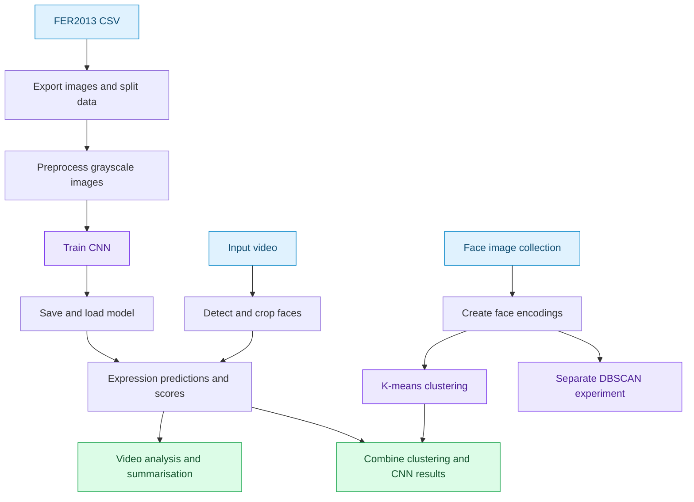

# Facial Expression Recognition · Individual Extension


**Samik Hafeez · 2024 coursework development**

An exploration of facial expression classification, video processing and face clustering. This stage extends the earlier notebook work by bringing CNN predictions, emotion scores, video summarisation and clustering experiments into one project.

[Main notebook](Main%20code%20file/Main_project_file.ipynb) · [Clustering notebook](Face_clustering/face_clustering.ipynb) · [Method](#how-the-project-works) · [Reproduction notes](#reading-and-reproducing-the-work)

---

## What this stage explores

| Area | Implementation in the original notebooks |
| :--- | :--- |
| Supervised learning | A convolutional neural network trained on images extracted from FER2013 |
| Video analysis | Face detection, expression predictions, emotion scores and video summarisation |
| Unsupervised learning | Face encodings with K-means and a separate DBSCAN experiment |
| Integration | A final notebook section combining CNN and K-means results |

The contribution of this version is the wider workflow: moving from classifying a face to experimenting with how predictions and face groupings can be used within video analysis. Clustering groups similar face encodings; it does not provide verified identities.

## How the project works



This diagram summarises the existing notebook sections. It is a reading guide to the experiments, rather than a claim that every section forms a single deployable application.

## Notebook guide

| Notebook | Reading order |
| :--- | :--- |
| [Main project](Main%20code%20file/Main_project_file.ipynb) | Dataset creation → preprocessing → CNN → training → saved model → video prediction → evaluation → summarisation → face encodings → K-means → combined results |
| [Face clustering](Face_clustering/face_clustering.ipynb) | Library setup → encoding demonstration → K-means → model persistence → DBSCAN comparison |

The existing figures, training logs, predictions and video outputs remain in their original locations. Open the notebooks to inspect the recorded results alongside the code that produced them.

## Reading and reproducing the work

The saved notebooks can be reviewed without executing them. Re-running them requires the original data, model files, face-recognition dependencies and media inputs. Several cells use Windows paths from the development computer, while the clustering notebook includes Colab-specific setup. These paths must be adapted to a new environment before execution.

The main notebook exports a random split from the FER2013 CSV rather than following its official `Usage` split. Its testing generator is also supplied during training as validation data. Consequently, the recorded evaluation should be read as coursework evidence, not as an independent benchmark or compared directly with later EmoSense results.

## Project layout

```text
Final Project/
├── Main code file/       Main notebook, saved model and media outputs
├── Face_clustering/      K-means and DBSCAN notebook and supporting files
├── dataset/              Existing local data
├── Main code file 2/     Additional development copy
└── Main code file.zip    Original archive
```

The additional copy and archive are retained as development material as ignored local files in this checkout. They are not presented as separate projects or independent improvements.

## Place in the development journey

**Project-2 coursework → individual CNN and clustering extension → modular EmoSense → Apple Silicon experiments → AffectNet experiments.**

This is the notebook-based extension in that progression. Later stages explore application structure, reusable training pipelines, multiple architectures and evaluation reporting. A later version does not automatically imply a higher score.

---

*Presentation update: notebook headings and documentation only. Executable cells, stored outputs, model files and datasets are preserved.*
